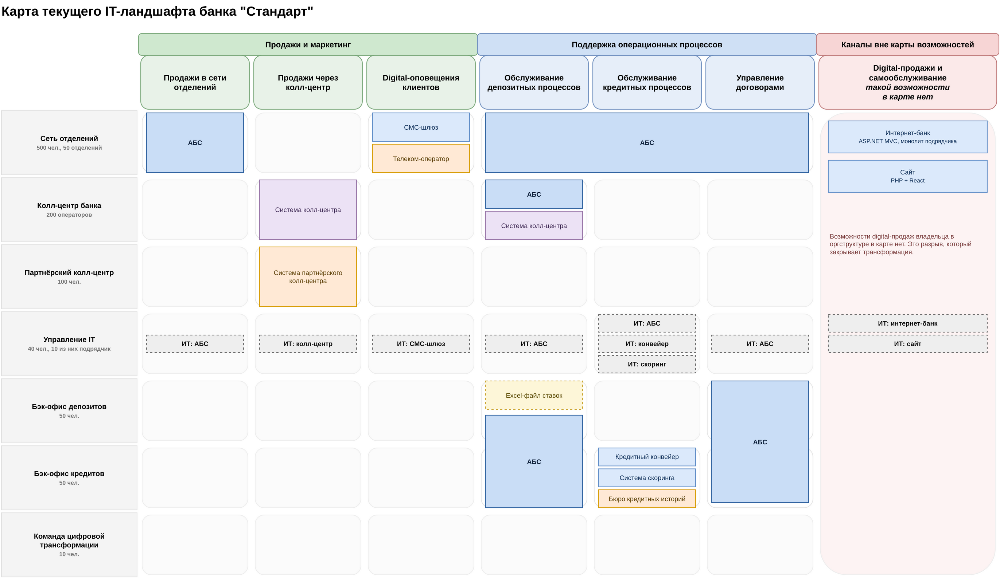
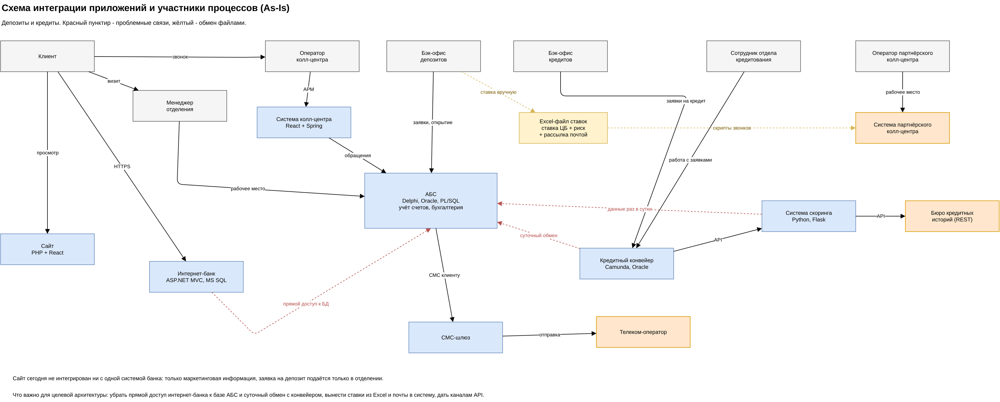

# Задание 1. Карта IT-ландшафта и схема интеграции приложений

## Карта IT-ландшафта

Строки - подразделения из описания структуры банка, колонки - бизнес-возможности второго уровня из карты возможностей задания. В клетках - IT-системы, которые поддерживают возможность в этом подразделении.

На диаграмме цвет чипа показывает владельца: синий - система банка, сиреневый - платформа подрядчика, оранжевый - внешняя система, желтый пунктир - артефакт вне системы (Excel-файл ставок). В бизнес-строках чип означает, что подразделение пользуется системой. В строке "Управление IT" серый пунктирный чип с меткой "ИТ" означает, что систему разрабатывает и поддерживает отдел: это вторая роль подразделения, а не дубль. Внешние системы (БКИ, телеком-оператор, система партнерского колл-центра) в строку ИТ не входят: их банк не разрабатывает и не поддерживает.

Три вывода:

- **АБС участвует в девяти клетках бизнес-строк и покрывает четыре возможности из шести.** В строке ИТ она отмечена в тех же колонках. Любое изменение в депозитном или кредитном процессе упирается в нее, а она масштабируется только вертикально.
- **Управление IT не владеет ни одной возможностью** - оно обеспечивает их. В строке ИТ семь систем: АБС, интернет-банк, сайт, система колл-центра, кредитный конвейер, скоринг, СМС-шлюз. Вся поддержка и развитие лежат на 40 человеках, а трансформация добавляет четыре сервиса и режим 24/7. Узкое место не только база АБС, но и команда.
- **Digital-каналы в карте отсутствуют.** Интернет-банк и сайт - каналы продаж и самообслуживания, но возможности digital-продаж в карте курса нет, и владельца в оргструктуре тоже нет. При этом ИТ их поддерживает. Это разрыв, который и закрывает трансформация.

## Кредитный процесс (as-is)

1. Клиент приходит в отделение, менеджер оформляет заявку **в АБС**.
2. Заявка остаётся в АБС и **раз в сутки** через интеграцию по базе передаётся в **кредитный конвейер** (Camunda).
3. Менеджер отдела кредитования работает с заявкой в конвейере. В процессе **по API** вызывается **система скоринга**.
4. Скоринг берёт данные из трёх источников: **бюро кредитных историй** (онлайн по REST), данные клиентов **из АБС** (раз в сутки), история платежей по кредиту (хранится в АБС, номера платежей - в конвейере).
5. Решение о выдаче принимает **сотрудник**. Одобренные заявки получают финальный статус и **раз в сутки** уходят обратно в АБС, где проводятся платежи.

Что в этом процессе мешает целям бизнеса:

- заявка не может появиться раньше, чем клиент пришёл в отделение.
- суточный обмен задаёт нижнюю границу срока решения - сутки только на передачу, при цели "решение в течение одного дня".
- предодобренных предложений нет: скоринг считает только в момент заявки.
- данные для скоринга разъезжаются по времени: БКИ - онлайн, АБС - сутки назад.

## Схема интеграции

Все связи подписаны прямо на диаграмме. Красным пунктиром отмечены три проблемные: прямой доступ интернет-банка к базе АБС, суточный обмен конвейера с АБС и передача данных скоринга из АБС раз в сутки. Жёлтым пунктиром - обмен файлами: Excel-файл ставок с ручной рассылкой почтой и скрипты звонков для партнёрского колл-центра.

Отдельно отмечено, что сайт сегодня не интегрирован ни с одной системой банка: он показывает только маркетинговую информацию, и заявка на депозит подаётся исключительно в отделении.
