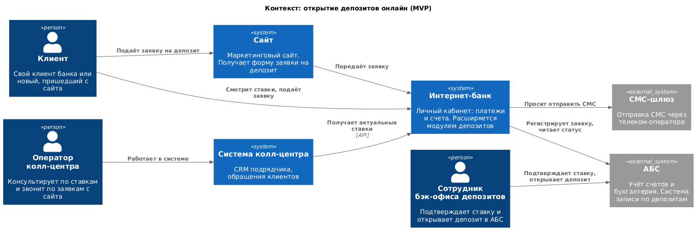
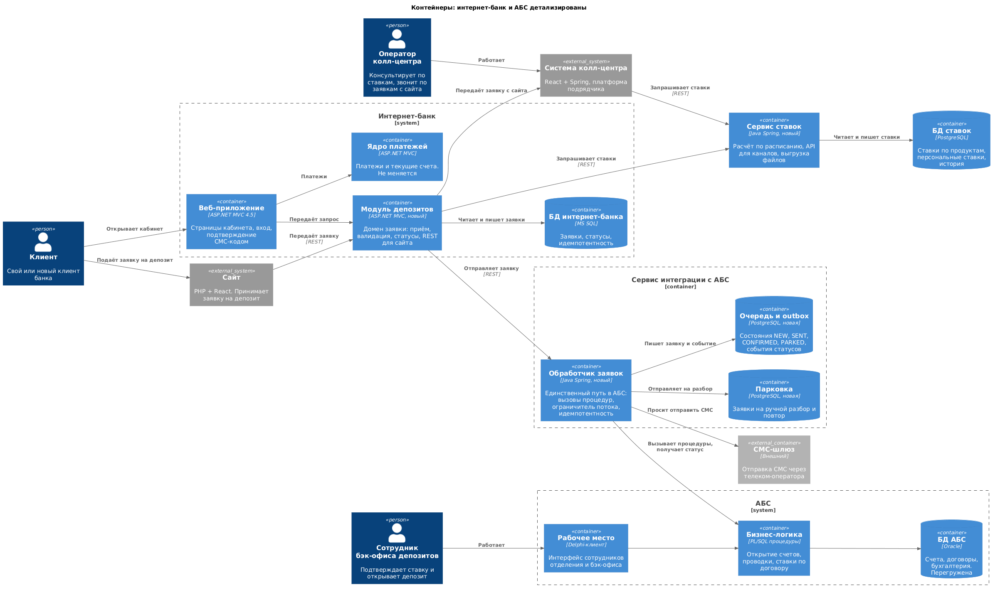

# ADR. Открытие депозитов онлайн (MVP)

**Название задачи** - Открытие депозитов и накопительных счетов через интернет-банк и заявка на депозит с сайта (MVP, горизонт 6 месяцев)
**Автор** - команда цифровой трансформации розничного бизнеса банка "Стандарт"
**Дата** - 17.11.2026
**Статус** - предложено к реализации

## Контекст

Клиент может открыть депозит только в отделении - ставку считают вручную в Excel-файле, ежедневно рассылают почтой в бэк-офис, ожидание в отделении занимает от 20 минут до часа. Интернет-банк умеет только платежи и текущие счета и ходит напрямую в базу АБС. Цель MVP - принимать заявку на депозит онлайн в интернет-банке и на сайте, а обработку на первом этапе оставить за бэк-офисом.

Ограничения, которые задают решение.

- база АБС перегружена и масштабируется только вертикально (+R5).
- прямая работа интернет-банка с АБС в новом процессе не допускается (+R2).
- функционал СМС находится в ядре интернет-банка, доработка подрядчиком нежелательна (+R1).
- новый стек должен быть совместим с существующим и понятен сотрудникам банка (S1, S2).
- сервисы должны работать 24/7 с доступностью 99,9% (R1, R2).

## Функциональные требования

| № | Действующие лица или системы | Use Case | Описание |
| --- | --- | --- | --- |
| UC1 | Клиент, интернет-банк | Просмотр депозитов и персональных ставок | Клиент видит список доступных депозитов с актуальными и персональными ставками |
| UC2 | Клиент, сайт | Заявка на депозит с сайта | Новый клиент оставляет Ф.И.О. И телефон. Данные передаются в колл-центр |
| UC3 | Менеджер колл-центра, система колл-центра | Звонок по заявке | Менеджер видит заявку с сайта, консультирует и фиксирует обращение |
| UC4 | Клиент, интернет-банк | Подача заявки на депозит | Клиент указывает счет и сумму, подтверждает операцию СМС-кодом. Заявка регистрируется |
| UC5 | Бэк-офис депозитов, АБС | Подтверждение и открытие | Сотрудник бэк-офиса подтверждает ставку и открывает депозит в АБС по текущему процессу |
| UC6 | Сервис интеграции с АБС, СМС-шлюз | Уведомление клиента | СМС уходит после подтверждения ставки и после открытия депозита |
| UC7 | Сервис ставок | Расчет ставок по расписанию | Ежедневный пересчет ставок из ставки рефинансирования ЦБ и уровня кредитного риска |
| UC8 | Оператор колл-центра, система колл-центра | Консультация по ставкам | Оператор получает актуальные ставки по API из сервиса ставок |

## Нефункциональные требования

| № | Требование |
| --- | --- |
| NF1 | Доступность 24/7 и 99,9% для новых сервисов. Развёртывание в обоих ЦОД, переключение при сбое |
| NF2 | Отклик всех операций в миллисекундах. Справочные данные не должны грузиться секундами |
| NF3 | Горизонтальное масштабирование новых сервисов. АБС не масштабируется и защищена от всплесков |
| NF4 | Прямые вызовы интернет-банка к базе или API АБС в новом процессе запрещены |
| NF5 | СМС-функционал реализуется силами банка, ядро интернет-банка не дорабатывается подрядчиком |
| NF6 | Технологии совместимы с существующими (MS SQL, Oracle, PostgreSQL). Экспертиза внутри банка |
| NF7 | Идемпотентность приема заявок - повторная отправка не создает дубль |
| NF8 | Разграничение доступа - сотрудники депозитов и кредитов не видят данные друг друга |
| NF9 | Заявка не теряется при сбое: очередь с состояниями, outbox, парковка и ежедневная сверка. RTO 30 минут, RPO 5 минут |

## Решение

### Границы решения

В объём входят - модуль депозитов внутри монолита интернет-банка, сервис интеграции с АБС, сервис ставок с собственной базой, SFTP-выгрузка ставок для партнёрского колл-центра. Не входят - изменение ядра платежей интернет-банка, доработка АБС сверх новых процедур, кредитный контур (см. ADR Task5).

### Модуль депозитов в интернет-банке

Домен заявки остаётся в монолите, но выделяется в отдельный модуль со своим API - страницы кабинета, приём заявки, статусы, подтверждение СМС-кодом. Ядро платежей не затрагивается. Сайт подаёт заявку в тот же модуль по REST, поэтому правила приёма заявки и валидация существуют в одном месте. Стек остаётся .NET Framework 4.5 - команда банка его знает, подрядчик по ядру не нужен.

### Сервис интеграции с АБС

Единственная точка, где решение соприкасается с АБС. Сервис принимает заявку от модуля депозитов, вызывает процедуры АБС, получает статус и публикует СМС. Буфер не в памяти и не в файле, а в таблице БД со состояниями.

- **надежная очередь.** Состояния NEW, SENT, CONFIRMED, PARKED. В записи - тело вызова, ключ идемпотентности, номер попытки, время следующей попытки, идентификатор заявки и correlation ID. Доставка at-least-once: воркер вызывает процедуры АБС, успех фиксирует CONFIRMED вместе с номером документа АБС, ошибка дает повтор с нарастающей паузой, после N попыток заявка уходит в PARKED с причиной и ручным разбором в админ-интерфейсе.
- **ограничитель потока** - число параллельных вызовов процедур АБС ограничено, онлайн-пик не выедает базу.
- **идемпотентность** - у заявки уникальный внешний идентификатор; повторный вызов процедуры возвращает существующий документ, а не создает второй.
- **сверка** - ежедневное сравнение заявок сервиса с документами АБС; расхождения уходят в парковку и в отчет.

### Outbox и путь к брокеру

Смена статуса заявки и запись события в outbox происходят в одной транзакции, отдельный релей публикует события подписчикам. В MVP подписчик один - уведомления и обновление статуса в модуле депозитов. На горизонте года релей заменяется продюсером Kafka, таблица остается той же.

Почему так, а не брокер сразу: брокер сам по себе не дает надежности, ее дают outbox, идемпотентный потребитель, парковка и сверка. Брокер нужен для нескольких потребителей и развязки по времени, поэтому он приходит на горизонте года, как в роадмапе, а не как условие сохранности заявки.

### Режимы отказа

| Ситуация | Что видит клиент | Что с заявкой | Кто разбирает |
| --- | --- | --- | --- |
| Таймаут АБС | Заявка в обработке | Остается в NEW, повтор с backoff | Дежурный по мониторингу |
| Ошибка процедуры АБС | Заявка в обработке | Повтор, после N попыток PARKED с причиной | Бэк-офис и дежурный |
| Падение сервиса после вызова АБС до подтверждения | Заявка в обработке | Повтор по тому же ключу, АБС возвращает существующий документ | Автоматика, при расхождении дежурный |
| Дублирующая отправка | Ничего не меняется | Второй вызов возвращает тот же документ по внешнему ID | Автоматика |
| Недоступна БД сервиса | Канал получает 503 и повторяет | Заявка не теряется на стороне канала, ключ идемпотентности сохраняет ее | Дежурный |

### Сервис ставок

Расчёт ставок переезжает из Excel целиком - по расписанию сервис читает ставку рефинансирования ЦБ и уровень кредитного риска банка, считает ставки по продуктам и сохраняет их. Бэк-офисы депозитов и кредитов работают со ставками в одном месте, доступ разграничен ролями (NF8). Потребители - модуль депозитов (показ ставок в кабинете), система колл-центра (консультации), выгрузка файлов для партнёрского колл-центра. АБС из пути чтения ставок уходит.

Почему не в АБС - расчёт и хранение остались бы в legacy, а все потребители зависели бы от перегруженной базы (NF3). Почему не в модуле депозитов - ставки нужны кредитному контуру и колл-центрам, депозитный модуль стал бы общей свалкой.

### Поток заявки (MVP)

1. Клиент в интернет-банке видит ставки из сервиса ставок, подаёт заявку и подтверждает её СМС-кодом. Модуль депозитов регистрирует заявку в своей базе.
2. Модуль передает заявку в сервис интеграции. Тот ставит ее в очередь и вызывает процедуру АБС, сохраняя номер заявки и внешний идентификатор.
3. Бэк-офис подтверждает ставку и открывает депозит в АБС.
4. Статус возвращается в сервис интеграции, событие пишется в outbox, клиенту уходит СМС. Модуль отдает клиенту актуальный статус на странице.

### Развёртывание и наблюдаемость

Сервисы stateless, разворачиваются в обоих ЦОД за существующим балансировщиком. Собственные базы - с репликацией. Каждый шаг заявки получает идентификатор и пишется в лог с этим идентификатором, чтобы заявку можно было проследить по системам. Очередь наблюдаема: глубина, возраст самой старой записи в NEW, число PARKED, алерты на пороги.

## Альтернативы

| Альтернатива | Почему отклонена |
| --- | --- |
| Доработка ядра интернет-банка подрядчиком | Каждое изменение ядра - очередь у подрядчика и зависимость от него. Задание прямо просит этого избежать (+R1) |
| Прямой доступ интернет-банка к базе АБС | Именно из-за этого база перегружена. Противоречит +R2 и NF4 |
| Отдельный SPA-фронт и сервис депозитов | Чистые границы, но переписывание части интернет-банка, дублирование аутентификации и дизайн-системы. Больше горизонта 6 месяцев |
| Хранение ставок в АБС | Расчет и точка отказа остаются в legacy, все потребители висят на перегруженной базе |
| Буфер в памяти или файле | Заявка теряется при падении процесса или сервера. Не отвечает NF9 |
| Kafka на MVP для событий заявки | Один потребитель событий на этом этапе не окупает брокер, которого банк никогда не эксплуатировал. Брокер вводится на горизонте года (ADR Task5) |

## Недостатки, ограничения, риски

- **Ручной бэк-офис в MVP.** Заявка обрабатывается человеком, поэтому "мгновенно" депозит не открывается. Это осознанный первый шаг - цель через год - открытие без участия бэк-офиса.
- **Очередь - точка отказа депозитных заявок.** Ее надежность обеспечивают репликация БД, RPO 5 минут, парковка и сверка; при недоступности БД сервиса канал получает 503 и повторяет заявку.
- **Зависимость от АБС.** Буфер и ограничитель потока снижают риск, но если процедуры АБС работают медленно, заявка будет ждать дольше миллисекунд.
- **Две системы хранения.** Заявка живёт в базе интернет-банка, договор - в АБС. Расхождение возможно и лечится сверкой по расписанию.
- **Эксплуатация новых сервисов.** Два сервиса на Java требуют мониторинга, обновлений и дежурства - этого у банка раньше не было.
- **СМС остаётся через шлюз телеком-оператора.** Шлюз банк не разрабатывает, но зависит от него по доступности.
- **Без SSO для сайта.** Новый клиент на сайте идентифицируется по телефону, полноценная идентификация происходит в отделении - это ограничение процесса, а не архитектуры.
