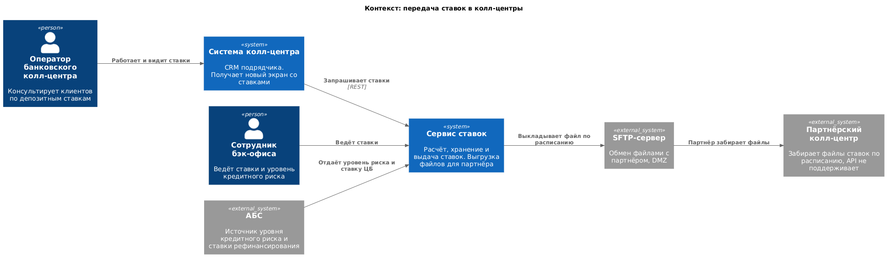
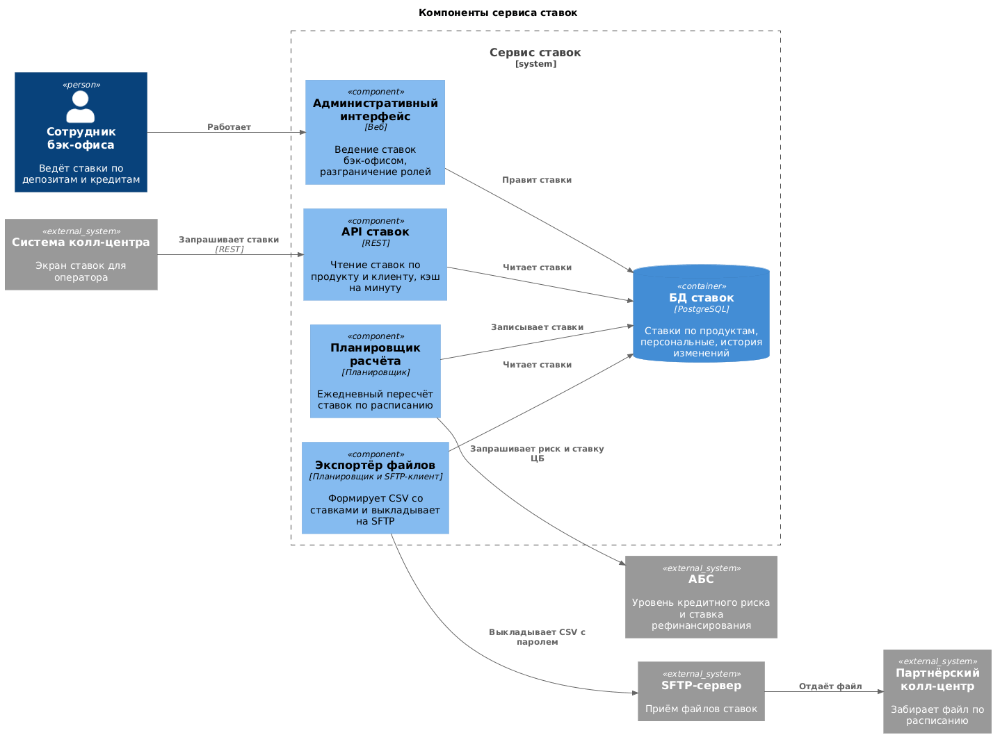

# ADR. Передача ставок в колл-центры

**Название задачи:** Передача актуальных ставок по депозитам в банковский и партнёрский колл-центры
**Автор:** команда цифровой трансформации розничного бизнеса банка "Стандарт"
**Дата:** 15.11.2026
**Статус:** предложено к реализации

## Контекст

После запуска маркетинговой кампании количество звонков вырастет: основная аудитория банка - люди старшего возраста, и им проще уточнить условия по телефону, чем разбираться в новом онлайн-процессе. Сегодня ставки считают в Excel и рассылают почтой, операторы колл-центра нужных данных не имеют вовсе.

Что требуется:

- операторы банковского колл-центра консультируют по актуальным ставкам.
- к работе подключается партнёрский колл-центр, у которого своя внешняя система.
- партнёр готов получать ставки только файлами, API-вызовы невозможны (например, через SFTP).
- решение опирается на текущий процесс работы со ставками, а не создаёт второй.

Из требований: ставки живут в сервисе ставок (ADR Task3), разграничение доступа между депозитным и кредитным бэк-офисом, поток звонков не должен вывести колл-центр из строя.

## Функциональные требования

| №   | Действующие лица или системы     | Use Case               | Описание                                                                                  |
| --- | -------------------------------- | ---------------------- | ----------------------------------------------------------------------------------------- |
| UC1 | Оператор банковского колл-центра | Просмотр ставок        | Оператор видит актуальные ставки по депозитам на экране в системе колл-центра             |
| UC2 | Оператор банковского колл-центра | Консультация клиента   | Во время звонка оператор называет ставку, не переключаясь в другую систему                |
| UC3 | Партнёрский колл-центр           | Получение файла ставок | Оператор партнёра забирает файл со ставками с SFTP по расписанию                          |
| UC4 | Сотрудник бэк-офиса              | Обновление ставок      | Изменение ставки в административном интерфейсе немедленно видно операторам банковского КЦ |
| UC5 | Сервис ставок                    | Выгрузка файла         | Формирование файла со ставками и выкладка его на SFTP по расписанию                       |
| UC6 | Сервис ставок                    | Отметка актуальности   | В файле есть время формирования и версия, чтобы партнёр видел, что данные не устарели     |

## Нефункциональные требования

| №   | Требование                                                                                                      |
| --- | --------------------------------------------------------------------------------------------------------------- |
| NF1 | Ставки в банковском колл-центре доступны без установки нового ПО: используется существующая система колл-центра |
| NF2 | Партнёр получает файл не реже согласованной частоты. В файле метка времени                                      |
| NF3 | API ставок выдерживает пик звонков. Кэш на стороне сервиса не даёт лишних запросов в БД                         |
| NF4 | Файлы с ставками - коммерческая информация, доступ по отдельной учётной записи SFTP и паролю на архив           |
| NF5 | Разграничение доступа: ставки правят только сотрудники бэк-офиса с соответствующей ролью                        |

## Решение

### Банковский колл-центр

В систему колл-центра добавляется экран со ставками: система раз в минуту забирает актуальные ставки из API сервиса ставок и держит их в кэше. Доработка идёт силами команды банка - система написана на Java Spring, у сотрудников команды АБС есть такая экспертиза, подрядчик нужен только на согласование изменений в своей платформе.

Почему не "показать оператору Excel": ставки обновляются в течение дня, ручная пересылка файлов гарантирует ошибки и устаревшие данные при разговоре с клиентом.

### Партнёрский колл-центр

Партнёр получает файл CSV, который формирует экспортёр сервиса ставок по расписанию и выкладывает на SFTP-сервер в DMZ. В файле: продукт, ставка, срок, валюта, время формирования, версия. Файл архивируется с паролем, пароль передаётся партнёру по защищённому каналу вне репозитория.

Почему не API: партнёр технически не готов к API-вызовам, это условие задания. Почему не почта, как сейчас: почта не даёт ни версии, ни времени, ни гарантии доставки, и её нельзя автоматизировать.

### Список крупных задач по системам

| Система                | Задачи                                                                                                                                                    |
| ---------------------- | --------------------------------------------------------------------------------------------------------------------------------------------------------- |
| Сервис ставок          | T1. API чтения ставок с кэшем. T2. экспортёр файлов и выкладка на SFTP. T3. административный интерфейс с ролями. T4. планировщик расчёта и история ставок |
| Система колл-центра    | T5. экран ставок для оператора. T6. клиент к API сервиса ставок с кэшем на минуту. T7. согласование доработки с подрядчиком платформы                     |
| SFTP-узел              | T8. развёртывание в DMZ, отдельная учётная запись для партнёра, пароль на архив, ротация ключей                                                           |
| Партнёрский колл-центр | T9. настройка забора файла по расписанию на стороне партнёра. T10. регламент обновления ставок и срок актуальности данных                                 |
| АБС                    | T11. выдача уровня кредитного риска и ставки рефинансирования сервису ставок                                                                              |

## Альтернативы

| Альтернатива                                        | Почему отклонена                                                                                  |
| --------------------------------------------------- | ------------------------------------------------------------------------------------------------- |
| Пересылка Excel по почте, как сейчас                | Нет версии и времени, ручной труд, ошибки при разговоре с клиентом. Не масштабируется на партнёра |
| API для партнёрского колл-центра                    | Партнёр технически не готов, условие задания - файлы                                              |
| Ручной ввод ставок в систему колл-центра оператором | Двойной ввод, расхождение с сервисом ставок при каждом изменении                                  |
| Отдельная витрина данных для колл-центра            | Ещё один компонент ради двух потребителей. API сервиса ставок с кэшем решает задачу проще         |

## Недостатки, ограничения, риски

- **Устаревший файл у партнёра.** Лечится меткой времени, версией и согласованным сроком актуальности. Риск остаточный - партнёр может не забрать файл.
- **Задержка обновления.** Ставки у оператора обновляются не мгновенно, а с кэшем до минуты. Для консультации это приемлемо, для оформления договора ставка всё равно проверяется в АБС.
- **Перегрузка колл-центра.** Рост звонков - риск процесса, а не архитектуры: ставки снимут часть вопросов, но очередь может вырасти. Решение о мощности колл-центра принимается отдельно.
- **Коммерческая тайна.** Ставки не персональные данные, но утечка наносит ущерб. Поэтому отдельная учётная запись, пароль на архив и журнал выгрузок.
- **Зависимость от SFTP.** Отказ узла или сети останавливает обновление у партнёра. Влияние ограничено, банковский колл-центр работает независимо.
