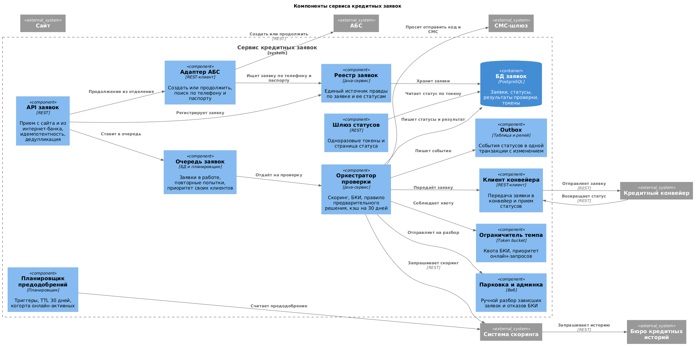

# ADR. Заявка на кредит онлайн

**Название задачи:** Подача заявки на кредит с сайта и из интернет-банка, предодобренные предложения, предварительное решение онлайн и решение в течение рабочего дня
**Автор:** команда цифровой трансформации розничного бизнеса банка "Стандарт"
**Дата:** 17.11.2026
**Статус:** предложено к реализации (горизонт года)

## Контекст

Сегодня кредитную заявку можно оформить только в отделении: менеджер заводит ее в АБС, оттуда раз в сутки она попадает в кредитный конвейер, скоринг вызывается в момент обработки, финальное решение принимает сотрудник. Предодобренных предложений нет вовсе, а клиент, подавший заявку с сайта, не получает ни решения, ни статуса.

Цели бизнеса: клиент подаёт заявку в интернет-банке и на сайте и получает решение в течение одного дня, если данных достаточно. Предодобренные предложения обрабатываются быстрее.

Ограничения из требований:

- обмен между базами АБС и кредитного конвейера ускорить нельзя (+R4), значит, заявку нельзя вести через АБС.
- скоринг нельзя нагружать дополнительными предрасчетами в рабочие часы (P4), а перенос расчета на ночь сам по себе нагрузку не убирает, поэтому нужен бюджет.
- бюро кредитных историй - внешняя система с квотой и своими сбоями (F10, +R7).
- АБС перегружена и не масштабируется горизонтально (P3, +R5).

Два решения по процессу, которые задают границу онлайн-решения:

- **обязательный визит в отделение.** Онлайн-решение предварительное, финальное решение и выдача кредита - только после идентификации клиента в отделении. Это осознанная мера против мошенничества и подмены личности: без личной проверки документов кредит не выдается. Предварительное решение не является офертой и действует 30 дней.
- **подтверждение телефона до запроса в БКИ.** Запрос в бюро выполняется только после подтверждения телефона СМС-кодом. Это закрывает заявки в чужое имя и не дает сжигать квоту БКИ на фейковые обращения.

## Функциональные требования

| № | Действующие лица или системы | Use Case | Описание |
| --- | --- | --- | --- |
| UC1 | Новый клиент, сайт | Заявка с сайта | Клиент видит предложение по ставке, оставляет Ф.И.О., телефон и паспортные данные, подтверждает телефон СМС-кодом. При достаточных данных получает предварительное решение с суммой и ставкой |
| UC2 | Свой клиент, интернет-банк | Предодобренное предложение | Клиент видит кредиты и персональное предодобренное предложение. Подает заявку с подтверждением СМС-кодом |
| UC3 | Сотрудник отделения, АБС | Продолжение заявки | В АБС менеджер вызывает "создать или продолжить", сервис находит заявку с сайта по телефону и паспорту, менеджер продолжает ее, а не заводит новую |
| UC4 | Сервис кредитных заявок, система скоринга | Проверка | Скоринг вызывается по API. Для нового клиента источник данных - БКИ, для своего - данные АБС и история платежей |
| UC5 | Сервис кредитных заявок, конвейер | Передача заявки | Заявка уходит в конвейер по REST сразу после проверки, минуя суточный обмен |
| UC6 | Сотрудник кредитования, конвейер | Решение | Сотрудник принимает финальное решение по заявке в конвейере, как сейчас |
| UC7 | Сервис кредитных заявок, СМС-шлюз | Уведомление о статусе | Клиент получает СМС при изменении статуса заявки, в СМС есть номер заявки и ссылка на страницу статуса |
| UC8 | Планировщик предодобрений | Предодобрение | Инкрементальный расчет предодобренных предложений по триггерам и TTL, результат хранится и показывается в канале |
| UC9 | Сервис кредитных заявок | Деградация при отказе БКИ | Заявка принимается, получает статус ожидания, повторяется по расписанию, затем уходит на ручную обработку |
| UC10 | Новый клиент, сайт | Подтверждение телефона | Клиент вводит код из СМС; без подтверждения заявка не уходит в БКИ |
| UC11 | Клиент, сайт | Статус заявки | Клиент открывает страницу статуса по одноразовому токену из СМС и видит актуальное состояние заявки |

## Нефункциональные требования

| № | Требование |
| --- | --- |
| NF1 | Доступность каналов 24/7 и 99,9%. Сервис stateless и разворачивается в обоих ЦОД |
| NF2 | Синхронный ответ на заявку p95 3 с, p99 8 с; ожидание в открытом соединении не более 15 с. Дальше клиент получает "заявка принята" и СМС со ссылкой на статус |
| NF3 | Ограничитель темпа под квоту договора с БКИ: не более 3 RPS и 10 000 запросов в сутки. Дедупликация по клиенту |
| NF4 | Предрасчет скоринга: не более 1 300 вызовов в сутки и 1 RPS в окне 01:00-05:00, не более 5% мощности. Онлайн-запросы приоритетнее |
| NF5 | Идемпотентность: повторная отправка заявки не создает вторую |
| NF6 | Отказ клиенту по технической причине недоступности БКИ недопустим |
| NF7 | Персональные данные и кредитная история: сырой отчёт БКИ не хранится без юридического заключения |
| NF8 | Прослеживаемость: у заявки есть идентификатор, по которому видны все шаги проверки; поиск по нему p95 30 с |
| NF9 | Дедупликация: телефон, паспорт (хэш) и продукт, окно 30 дней; открытая заявка возвращается вместо новой |
| NF10 | Токен страницы статуса: 128 бит, одноразовый, TTL 30 дней, без персональных данных в ссылке, с ограничением частоты |
| NF11 | Аудит доступа к заявке: кто и когда смотрел решение и данные |
| NF12 | Поиск заявки в АБС по телефону и паспорту: p95 2 с |
| NF13 | Запрос в БКИ выполняется только после подтверждения телефона |

## Решение

### Сквозной сценарий нового клиента с сайта

1. Клиент заполняет Ф.И.О., телефон, паспортные данные и согласие на проверку.
2. Сайт отправляет заявку в сервис заявок по REST с ключом идемпотентности.
3. Сервис проверяет дубль и регистрирует заявку в реестре.
4. Клиент подтверждает телефон СМС-кодом; без подтверждения запрос в БКИ не выполняется.
5. Запрос в БКИ в пределах квоты, затем скоринг и правило предварительного решения.
6. Если уложились в 15 секунд, решение показывается в форме сразу: предварительно одобрено до N под X% или отказ без деталей скоринга. Если нет - "заявка принята", проверка идет фоном.
7. СМС с номером заявки и ссылкой на страницу статуса.
8. Клиент приходит в отделение. Менеджер начинает оформление в АБС, АБС вызывает "создать или продолжить", сервис находит заявку по телефону и паспорту и возвращает номер и онлайн-решение.
9. Менеджер проводит идентификацию и продолжает ту же заявку; сервис передает ее в конвейер по REST с результатом онлайн-проверки.
10. Сотрудник кредитования принимает финальное решение, статус возвращается в сервис.
11. СМС на изменение статуса, страница статуса показывает актуальное состояние.

### Предварительное решение и визит в отделение

Онлайн-решение предварительное: финальное решение и выдача - за сотрудником после идентификации. Обязательный визит в отделение - осознанное решение против мошенничества, оно фиксируется здесь, в ограничениях и в комментарии для ревьюера. Предварительное решение не оферта, действует 30 дней; если клиент не пришел, оно истекает.

### Подтверждение телефона

Запрос в БКИ выполняется только после подтверждения телефона СМС-кодом. Это закрывает заявки в чужое имя, не дает сжигать квоту БКИ на фейковые обращения и повышает качество данных. Мгновенность сохраняется: решение приходит через 10-20 секунд после кода, а для клиентов интернет-банка телефон уже подтвержден.

### Возврат результата на сайт

Быстрый путь - ответ в форме в пределах 15 секунд. Медленный - "заявка принята" и СМС со ссылкой на страницу статуса. Страница статуса открывается по одноразовому токену на 128 бит, TTL 30 дней, без персональных данных в ссылке, с ограничением частоты. В ответе на повтор по ключу идемпотентности - только номер заявки и статус, без суммы и ставки.

### Продолжение заявки из АБС

АБС при оформлении кредитной заявки вызывает сервис "создать или продолжить". Сервис ищет открытую заявку по телефону и паспорту и возвращает номер и предварительное решение; менеджер видит их в форме и продолжает ту же заявку. Если сервис недоступен, заявка оформляется по старой схеме, а при сверке связывается по телефону и паспорту и помечается "создана в отделении". Новых таблиц и экранов в АБС не появляется, кроме вызова.

### Дедупликация и ключ идемпотентности

Ключ дедупликации - телефон, паспорт (хэш) и продукт, окно 30 дней. Ключ идемпотентности генерирует сервер сайта и хранит в сессии, браузер его не выбирает; ключ связан с отпечатком тела запроса, при несовпадении - ответ 409 и запись в аудит. Ключ не является средством аутентификации: он защищает от дублей, а личность подтверждают телефон и отделение.

### Предодобрение и предрасчет

Инкрементальный расчет по триггерам: изменение данных клиента, смена продукта или ставки, список кампании, истечение TTL 30 дней. Когорта - онлайн-активные клиенты, 40 000; при TTL 30 дней это около 1 300 вызовов в сутки и не более 1 RPS в окне 01:00-05:00. Общий ограничитель темпа с онлайн-запросами, онлайн приоритетнее. Ночной пересчет всей базы не используется: он переносит нагрузку, а не убирает ее, и не проходит по квоте БКИ.

### Деградация при недоступности БКИ

Таймауты короткие, на клиенте стоит предохранитель, повторы идут по нарастающей паузе. Заявка живёт в статусе "ожидает внешней проверки" и не отклоняется: отказ за чужой сбой недопустим (NF6). Если за согласованное время ответа нет, заявка уходит в конвейер с пометкой "нет данных БКИ" - сотрудник решает по своим данным и при необходимости запрашивает бюро вручную.

### Взаимодействие с конвейером

Заявка передается по REST сразу после проверки. Конвейер получает новый канал поступления, но логика обработки и решение сотрудника остаются прежними. Статус из конвейера возвращается в сервис заявок и на страницу статуса. Суточный обмен АБС - конвейер продолжает работать для заявок из отделений, его не ускоряем и не ломаем (+R4).

### Границы

Не входят: изменение модели скоринга, замена конвейера, автоматическое принятие финального решения и выдача кредита без идентификации. АБС по-прежнему система учета кредитных договоров.

## Альтернативы

| Альтернатива | Почему отклонена |
| --- | --- |
| Оставить "заявка принята" без решения и статуса | Задание требует решение при достаточных данных, клиенту незачем идти в отделение |
| Заявка кладется в АБС, дальше суточный обмен в конвейер | Сутки только на передачу. Цель "решение в течение дня" не достигается, а обмен ускорить нельзя (+R4) |
| Доработка кредитного конвейера вместо нового сервиса | У конвейера нет приема из каналов и защиты от нагрузки на БКИ. Получился бы второй конвейер |
| Отдельное рабочее место менеджера в сервисе | Кейс говорит про АБС, сотруднику добавляется второе окно |
| Витрина заявок в АБС | Дублирование данных и лаг; живой вызов "создать или продолжить" и деградация проще |
| Считать предодобрение при входе клиента в канал | Тот же пик в рабочие часы, что и раньше; противоречит P4 и квоте БКИ |
| Kafka для событий заявок уже в MVP | Один потребитель не окупает эксплуатацию брокера. Вводится на горизонте года, outbox к этому готов |

## Недостатки, ограничения, риски

- **Квота БКИ.** 10 000 запросов в сутки - допущение, значение по договору неизвестно. До уточнения ограничитель настраивается консервативно, предрасчет идет только по онлайн-активной когорте.
- **Кэш 30 дней может устареть.** Клиент с изменившейся ситуацией получит решение по старой оценке. Поэтому при подаче заявки проверка повторяется по упрощённой процедуре.
- **Второй канал мимо АБС.** Заявка живет в сервисе, договор - в АБС. Расхождение закрывается ежедневной сверкой, без нее возможны "висящие" заявки.
- **Обязательный визит снижает конверсию.** Часть клиентов не дойдет до отделения; это сознательная плата за защиту от мошенничества.
- **СМС на подтверждение телефона** стоит денег и зависит от телеком-оператора; при его сбое заявка не проходит проверку.
- **Эксплуатация.** Ещё один сервис на Java, брокер на следующем шаге - нужны дежурство, мониторинг, документация.
- **Юридический вопрос по хранению отчёта БКИ** не закрыт и вынесен как открытый.
