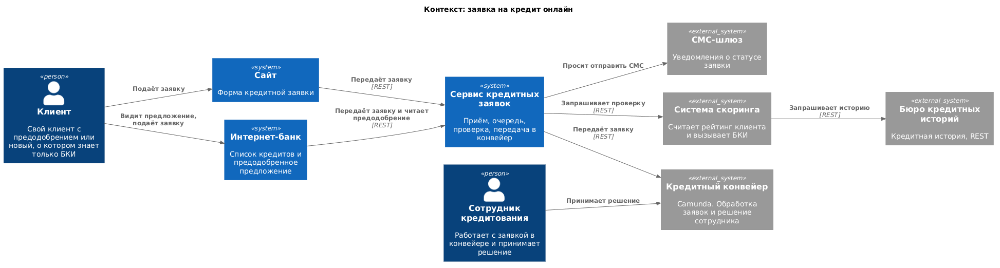

# ADR. Заявка на кредит онлайн

**Название задачи:** Подача заявки на кредит с сайта и из интернет-банка, предодобренные предложения, решение в течение рабочего дня
**Автор:** команда цифровой трансформации розничного бизнеса банка "Стандарт"
**Дата:** 15.11.2026
**Статус:** предложено к реализации (горизонт года)

## Контекст

Сегодня кредитную заявку можно оформить только в отделении: менеджер заводит её в АБС, оттуда раз в сутки она попадает в кредитный конвейер, скоринг вызывается в момент обработки, финальное решение принимает сотрудник. Предодобренных предложений нет вовсе.

Цели бизнеса: клиент подаёт заявку в интернет-банке и на сайте и получает решение в течение одного дня, если данных достаточно. Предодобренные предложения обрабатываются быстрее.

Ограничения из требований:

- обмен между базами АБС и кредитного конвейера ускорить нельзя (+R4) - значит, заявку нельзя вести через АБС.
- скоринг нельзя нагружать дополнительными предрасчётами в рабочие часы (P4).
- бюро кредитных историй - внешняя система с квотой и своими сбоями (F10, +R7).
- АБС перегружена и не масштабируется горизонтально (P3, +R5).

## Функциональные требования

| №   | Действующие лица или системы              | Use Case                     | Описание                                                                                                                           |
| --- | ----------------------------------------- | ---------------------------- | ---------------------------------------------------------------------------------------------------------------------------------- |
| UC1 | Новый клиент, сайт                        | Заявка с сайта               | Клиент видит предложение по ставке, оставляет Ф.И.О. и телефон. При наличии паспортных данных сразу получает решение по данным БКИ |
| UC2 | Свой клиент, интернет-банк                | Предодобренное предложение   | Клиент видит кредиты и персональное предодобренное предложение. Подаёт заявку с подтверждением СМС-кодом                           |
| UC3 | Сотрудник отделения, АБС                  | Продолжение заявки           | Найдя предодобренную заявку с сайта, сотрудник продолжает её, а не заводит новую                                                   |
| UC4 | Сервис кредитных заявок, система скоринга | Проверка                     | Скоринг вызывается по API. Для нового клиента источник данных - БКИ                                                                |
| UC5 | Сервис кредитных заявок, конвейер         | Передача заявки              | Заявка уходит в конвейер по REST сразу после проверки, минуя суточный обмен                                                        |
| UC6 | Сотрудник кредитования, конвейер          | Решение                      | Сотрудник принимает решение по заявке в конвейере, как сейчас                                                                      |
| UC7 | Сервис кредитных заявок, СМС-шлюз         | Уведомление о статусе        | Клиент получает СМС при изменении статуса заявки                                                                                   |
| UC8 | Сервис кредитных заявок                   | Ночной расчёт предодобренных | По своим клиентам ночью считается предодобренное предложение, результат хранится и показывается в канале                           |
| UC9 | Сервис кредитных заявок                   | Деградация при отказе БКИ    | Заявка принимается, получает статус ожидания, повторяется по расписанию, затем уходит на ручную обработку                          |

## Нефункциональные требования

| №   | Требование                                                                                       |
| --- | ------------------------------------------------------------------------------------------------ |
| NF1 | Доступность каналов 24/7 и 99,9%. Сервис stateless и разворачивается в обоих ЦОД                 |
| NF2 | Отклик приёма заявки в миллисекундах: клиент не ждёт результата проверки в открытом соединении   |
| NF3 | Ограничитель темпа под квоту договора с БКИ. Дедупликация по клиенту                             |
| NF4 | Скоринг не нагружается предрасчётами в рабочие часы: предодобренные считаются ночью              |
| NF5 | Идемпотентность: повторная отправка заявки не создаёт вторую                                     |
| NF6 | Отказ клиенту по технической причине недоступности БКИ недопустим                                |
| NF7 | Персональные данные и кредитная история: сырой отчёт БКИ не хранится без юридического заключения |
| NF8 | Прослеживаемость: у заявки есть идентификатор, по которому видны все шаги проверки               |

## Решение

### Сервис кредитных заявок

Новый сервис на Java Spring (стек, знакомый командам банка - S2) принимает заявки с сайта и из интернет-банка, ведёт их в собственной базе, проводит проверку и передаёт в конвейер по REST. Он не заменяет ни скоринг, ни конвейер, ни АБС - он закрывает разрыв между каналом и конвейером, который сегодня преодолевается суточным обменом баз.

### Проверка и предодобрение

- **Свой клиент.** Предодобренное предложение считается ночью по расписанию: скоринг вызывается вне рабочих часов, результат хранится в БД заявок с TTL 30 дней. В канале клиент видит готовое предложение, при подаче заявки проверка повторяется по упрощённой процедуре.
- **Новый клиент.** Данных АБС нет, источник - только бюро кредитных историй: скоринг вызывается в момент заявки. Ответа ждём не в открытом соединении: клиент получает "заявка принята", проверка идёт фоном.
- **Кэш результата скоринга** на 30 дней снижает число обращений и к бюро, и к скорингу. Сырой отчёт БКИ не кэшируется - это открытый вопрос к юристам (NF7).
- **Ограничитель темпа** держит число запросов в рамках квоты договора. Поток новых клиентов идёт через очередь, а не напрямую в бюро (NF3).

### Деградация при недоступности БКИ

Таймауты короткие, на клиенте стоит предохранитель, повторы идут по нарастающей паузе. Заявка живёт в статусе "ожидает внешней проверки" и не отклоняется: отказ за чужой сбой недопустим (NF6). Если за согласованное время ответа нет, заявка уходит в конвейер с пометкой "нет данных БКИ" - сотрудник решает по своим данным и при необходимости запрашивает бюро вручную.

### Взаимодействие с конвейером

Заявка передаётся по REST сразу после проверки. Конвейер получает новый канал поступления, но логика обработки и решение сотрудника остаются прежними. Суточный обмен АБС - конвейер продолжает работать для заявок из отделений, его не ускоряем и не ломаем (+R4).

### Границы

Не входят: изменение модели скоринга, замена конвейера, автоматическое принятие решения без сотрудника. АБС по-прежнему система учёта кредитных договоров.

## Альтернативы

| Альтернатива                                                | Почему отклонена                                                                                                |
| ----------------------------------------------------------- | --------------------------------------------------------------------------------------------------------------- |
| Заявка кладётся в АБС, дальше суточный обмен в конвейер     | Сутки только на передачу. Цель "решение в течение дня" не достигается, а обмен ускорить нельзя (+R4)            |
| Доработка кредитного конвейера вместо нового сервиса        | У конвейера нет приёма из каналов и защиты от нагрузки на БКИ. Получился бы второй конвейер                     |
| Kafka для событий заявок на этом этапе                      | Один потребитель не окупает эксплуатацию брокера. Вводится позже, когда появится сервис уведомлений и аналитика |
| Онлайн-скоринг для всех клиентов при каждом открытии канала | Нагружает скоринг в рабочие часы и выедает квоту БКИ (P4, NF3)                                                  |
| Считать предодобренные при заходе клиента в канал           | Тот же эффект пиковой нагрузки в часы, когда скоринг и так загружен                                             |

## Недостатки, ограничения, риски

- **Квота БКИ.** Значение по договору неизвестно - оно первое, что надо уточнить. До уточнения ограничитель настраивается консервативно.
- **Кэш 30 дней может устареть.** Клиент с изменившейся ситуацией получит решение по старой оценке. Поэтому при подаче заявки проверка повторяется по упрощённой процедуре.
- **Второй канал мимо АБС.** Заявка живёт в сервисе, договор - в АБС. Расхождение закрывается сверкой, без неё возможны "висящие" заявки.
- **Эксплуатация.** Ещё один сервис на Java, брокер на следующем шаге - нужны дежурство, мониторинг, документация.
- **Юридический вопрос по хранению отчёта БКИ** не закрыт и вынесен как открытый.
